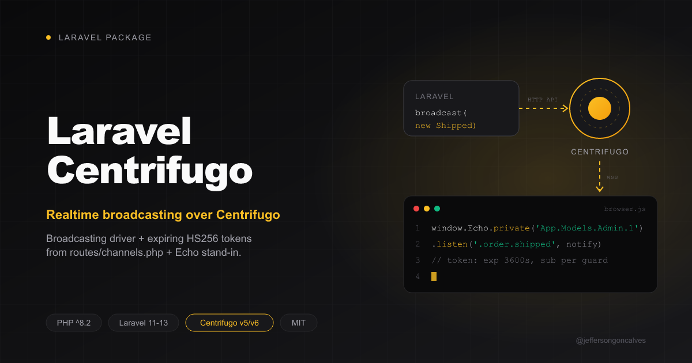

<div class="filament-hidden">



</div>

# Laravel Centrifugo

[](https://packagist.org/packages/jeffersongoncalves/laravel-centrifugo)
[](https://github.com/jeffersongoncalves/laravel-centrifugo/actions?query=workflow%3ATests+branch%3Amain)
[](https://github.com/jeffersongoncalves/laravel-centrifugo/actions?query=workflow%3A%22Fix+PHP+code+styling%22+branch%3Amain)
[](https://packagist.org/packages/jeffersongoncalves/laravel-centrifugo)
[](LICENSE.md)

Laravel broadcasting driver for [Centrifugo](https://centrifugal.dev) (v5/v6):

- **Publishes** events through Centrifugo's server HTTP API (`/api/broadcast`).
- **Authorizes** private channels with expiring HS256 subscription tokens, decided by your own `routes/channels.php` rules — guards included.
- **Ships a drop-in Laravel Echo stand-in** (built on `centrifuge-js`) covering what Filament and Livewire call: `Echo.private(...).listen()/.stopListening()`, `Echo.channel(...)`, `Echo.socketId()` and the `EchoLoaded` event. No npm install, no Pusher protocol.

Using Filament? See [`jeffersongoncalves/filament-centrifugo`](https://github.com/jeffersongoncalves/filament-centrifugo), which wires this into a panel's realtime notifications.

## Requirements

- PHP 8.2+, Laravel 11, 12 or 13
- A Centrifugo v5/v6 server

## Installation

You can install the package via composer:

```bash
composer require jeffersongoncalves/laravel-centrifugo
```

Optionally publish the config:

```bash
php artisan vendor:publish --tag="centrifugo-config"
```

## Centrifugo server

Minimal Centrifugo v6 `config.json`:

```json
{
  "client": {
    "token": { "hmac_secret_key": "<SECRET>" },
    "allowed_origins": ["https://your-app.com"]
  },
  "http_api": { "key": "<API_KEY>" }
}
```

Expose `/connection/websocket` to browsers (same origin behind a reverse proxy, or a subdomain like `ws.your-app.com`). Keep the admin UI off the public internet (`"admin": {"enabled": false}`).

## Configuration

```dotenv
BROADCAST_CONNECTION=centrifugo
CENTRIFUGO_API_URL=http://127.0.0.1:8000/api   # server HTTP API, reached from PHP
CENTRIFUGO_API_KEY=<API_KEY>                   # http_api.key
CENTRIFUGO_TOKEN_HMAC_SECRET=<SECRET>          # client.token.hmac_secret_key
CENTRIFUGO_URL=https://ws.your-app.com         # browser URL; empty = same origin /connection/websocket
CENTRIFUGO_TOKEN_TTL=3600                      # token lifetime (seconds), refreshed by centrifuge-js
```

The `centrifugo` broadcasting connection is registered for you — no edit to `config/broadcasting.php` is needed.

Enable Laravel's broadcasting auth route, which signs the subscription tokens (Laravel 11+):

```php
// bootstrap/app.php
->withBroadcasting(__DIR__.'/../routes/channels.php')
```

## Usage

Authorize channels as usual:

```php
// routes/channels.php
Broadcast::channel('App.Models.User.{id}', fn ($user, $id) => (string) $user->id === $id);

// A second guard, e.g. a Filament panel on `admin`:
Broadcast::channel('App.Models.Admin.{id}', fn ($admin, $id) => (string) $admin->id === $id, ['guards' => ['admin']]);
```

Add the script to authenticated pages only (guests can't get a token):

```blade
@auth
    <x-centrifugo::scripts />
@endauth

{{-- connect as the `admin` guard instead of the default one --}}
<x-centrifugo::scripts guard="admin" />
```

Then use `window.Echo` exactly like Laravel Echo:

```js
window.Echo.private(`App.Models.User.${userId}`)
    .listen('.order.shipped', (payload) => console.log(payload))
```

Livewire `#[On('echo-private:App.Models.User.{id},.order.shipped')]` listeners work too. The socket only opens on the first subscription.

### Multiple guards

Every guard that may connect must be listed in `centrifugo.guards` (default `['web']`):

```php
// config/centrifugo.php
'guards' => ['web', 'admin'],
```

The Centrifugo user id is the model class plus key in Laravel's channel style (`App.Models.Admin.1`), so a `User #1` and an `Admin #1` logged in on the same browser stay separate users.

### Not supported

Presence channels, whispers and `broadcast()->toOthers()` (`socketId()` returns an empty string).

## Testing

```bash
composer test
```

Rebuild the bundled script after changing `resources/js/echo.js`:

```bash
pnpm install && pnpm run build
```

## Changelog

Please see [CHANGELOG](CHANGELOG.md) for more information on what has changed recently.

## Contributing

Please see [CONTRIBUTING](.github/CONTRIBUTING.md) for details.

## Security Vulnerabilities

Please review [our security policy](../../security/policy) on how to report security vulnerabilities.

## Credits

- [Jefferson Gonçalves](https://github.com/jeffersongoncalves)
- [All Contributors](../../contributors)

## License

The MIT License (MIT). Please see [License File](LICENSE.md) for more information.
